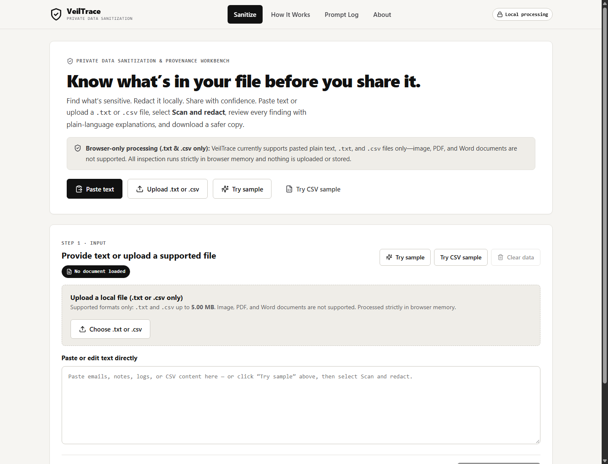
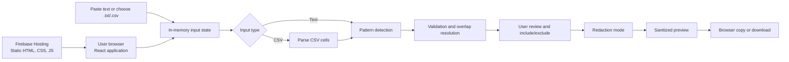

# VeilTrace

**Private Data Sanitization & Provenance Workbench**  
*Find what’s sensitive. Redact it locally. Share with confidence.*

**Live App (Firebase Hosting):** https://veiltrace-d05ac.web.app/  
**Architecture & Function Reference:** [docs/ARCHITECTURE.md](docs/ARCHITECTURE.md)  
**Development Prompt Log:** [PROMPT_LOG.md](PROMPT_LOG.md)

VeilTrace is a client-side single-page web application built with **Google Antigravity** and deployed on **Firebase Hosting** for the Google PromptWars challenge. It helps people—including non-technical users and older adults—inspect pasted text or `.txt` and `.csv` files locally in their browser for likely sensitive information, review plain-language explanations, redact matches, and download a safer copy.

## Screenshots

The screenshot shows the desktop input workspace with no document loaded. No user documents or personal data are included.



---

## Supported Formats (`.txt` and `.csv` Only)

VeilTrace currently supports **pasted plain text, `.txt`, and `.csv` files only**. Image, PDF, Word (`.docx`), and other document formats are **not supported** in this release.

- **Pasted or typed text**: Inspected directly in browser memory; exported as `.txt`.
- **Plain text files (`.txt`)**: Up to 5 MB per file (`MAX_FILE_BYTES = 5 * 1024 * 1024`); binary files disguised as `.txt` are rejected via null-byte inspection.
- **CSV files (`.csv`)**: Up to 5 MB per file; parsed and re-serialized using [PapaParse](https://www.papaparse.com/) (MIT) to preserve rows, columns, headers, quoting, commas, escaped quotes (`""`), and embedded line breaks.

### Unsupported Formats
Image sanitization, PDF extraction, Word (`.docx`) parsing, browser-local OCR, and image pixel redaction are not implemented in this release. Every visible control corresponds to a complete working `.txt` or `.csv` feature.

---

## Key Features & Post-Scan Workflow

1. **Focused Pre-Scan Input**: Before scanning, the workspace focuses on pasting text, uploading `.txt` / `.csv` files (with clear 5 MB size limits), loading synthetic samples (**Try sample** / **Try CSV sample**), and one prominent **Scan and redact** action—keeping empty result panels hidden.
2. **Deterministic PII & Network Detection**:
   - **Email addresses** (`EMAIL`, case-insensitive normalization)
   - **Phone numbers** (`PHONE`, Indian `+91` / `0`-prefixed / 10-digit and international `+...` formats)
   - **IPv4 addresses** (`IPV4`, strict `0–255` octet checks; rejects `999.42.10.300`, `10.20.30.40.50`, `v2.4.1.0`)
   - **IPv6 addresses** (`IPV6`, full & compressed `::` validation; rejects timestamps and malformed colons)
   - **Indian PAN format** (`PAN`, `[A-Z]{5}[0-9]{4}[A-Z]`, format recognition only)
   - **Aadhaar-like 12-digit format** (`AADHAAR`, boundary-guarded against 16-digit cards and longer IDs)
   - **Credit-card candidates** (`CARD`, 13–19 digits validated via `passesLuhnCheck`; Luhn-failing strings are rejected)
3. **Prominent Temporary Custom Terms (Session Memory Only)**:
   - Located directly below **Step 2 · Scan Summary** so users can add names, project labels, or ticket references that built-in patterns may miss.
   - Displays immediate confirmation feedback and updates detections and sanitized output live without persisting data.
4. **Three Redaction Modes & Interactive Review**:
   - **Full Mask**: `[REDACTED: EMAIL]`, `[REDACTED: CARD]`, etc.
   - **Partial Mask**: Conservative minimal context (last 4 digits for cards/Aadhaar/phones, minimal domain clue for emails, prefix for IPs, most chars masked for PAN).
   - **Consistent Pseudonymization**: Document-scoped sequential placeholders (`EMAIL_01`, `CARD_01`, etc.) per normalized value and category, with **New document / reset mappings**.
   - Click any highlighted match in **Highlighted Original** to inspect its category, status label, plain-language reason, and Include/Exclude control.
5. **Shaded Output, Guidance & Out-of-Date Tracking**:
   - **Sanitized Output** shades every replaced token while **Copy sanitized output** and **Download sanitized file** export exact plain text or RFC 4180 CSV.
   - Deterministic **What Changed** templates explain planned replacements in plain language.
   - Editing input after a scan flags results as out of date with a **Scan again** prompt.

---

## System Architecture Summary

See [docs/ARCHITECTURE.md](docs/ARCHITECTURE.md) for full architecture diagrams, data flow sequences, and function-level documentation.

### Runtime Architecture

Firebase Hosting delivers the static application bundle. After the page loads, the browser handles the complete sanitization workflow locally; the app does not send uploaded content to a processing service.



**Trust boundary:** Hosting serves the app code; file contents, custom terms, detection results, and pseudonym mappings remain in browser memory. Downloads are created locally from the sanitized result. There is no application backend, database, analytics pipeline, or AI API in the data path.

### Processing Sequence

1. The user pastes content or selects a supported `.txt` or `.csv` file.
2. The app validates the file and keeps its contents in browser memory.
3. Text is scanned directly; CSV is parsed into cells and scanned cell by cell.
4. Deterministic detectors validate candidates, then resolve overlapping matches.
5. The user reviews findings, adds optional session-only terms, and chooses which detections to redact.
6. The redaction engine produces the preview from the original input offsets and selected mode.
7. Copy and download actions use the sanitized output; CSV output is serialized back into CSV format.

For the module map, function reference, sequence diagram, and security controls, see [docs/ARCHITECTURE.md](docs/ARCHITECTURE.md).

| Module | Purpose | Key Exports |
|---|---|---|
| [src/types/veiltrace.ts](src/types/veiltrace.ts) | Core domain types | `EntityType`, `RedactionMode`, `Detection`, `CustomTerm`, `ParsedCsvDocument` |
| [src/lib/luhn.ts](src/lib/luhn.ts) | Payment card checksum validator | `passesLuhnCheck` |
| [src/lib/detector.ts](src/lib/detector.ts) | Pattern extractors, validators, overlap solver | `detectSensitiveData`, `ENTITY_META`, `ALL_ENTITY_TYPES` |
| [src/lib/redactor.ts](src/lib/redactor.ts) | Single-pass offset redaction & pseudonyms | `PseudonymRegistry`, `maskPartial`, `formatReplacement`, `buildRedactedSegments`, `applyRedactionsToText` |
| [src/lib/csv.ts](src/lib/csv.ts) | RFC 4180 CSV parsing, detection & serialization | `parseCsvContent`, `detectCsvDocument`, `redactCsvDocument` |
| [src/lib/guidance.ts](src/lib/guidance.ts) | Deterministic plain-language explanations | `buildScanSummarySentence`, `buildGuidanceStatements` |
| [src/lib/sampleData.ts](src/lib/sampleData.ts) | Synthetic test payloads (text & CSV) | `SYNTHETIC_SAMPLE_TEXT`, `SYNTHETIC_SAMPLE_CSV` |
| [src/components/SanitizeWorkspace.tsx](src/components/SanitizeWorkspace.tsx) | Primary workbench UI & browser file I/O | `SanitizeWorkspace` |

---

## Privacy Model

- **Static online code, local-only data processing**: VeilTrace’s static bundle is served via Firebase Hosting, while **100% of file reading, detection, redaction, and CSV export happens locally in browser memory**.
- **No external transmission or AI inspection**: No backend server, no database, no analytics, no authentication, no third-party fonts/scripts, and no Gemini / Firebase AI calls ever receive user files or extracted text.
- **No persistent storage of user content**: Working data and custom terms are never stored in `localStorage`, `sessionStorage`, `IndexedDB`, cookies, URL parameters, or console output. **Clear data** or closing the tab discards all working state.
- **Security Headers**: `firebase.json` configures `Content-Security-Policy` (`connect-src 'self'`, `script-src 'self'`, `object-src 'none'`), `X-Content-Type-Options: nosniff`, `X-Frame-Options: DENY`, `Referrer-Policy: no-referrer`, and `Permissions-Policy`.

---

## Known Limitations

- **Detection can miss or misclassify information**: Users must review results manually before sharing.
- **“No detections found” does not prove no sensitive information exists**: Names, addresses, passwords, or unstructured notes may not match deterministic patterns; use temporary session custom terms to catch extra items.
- **Luhn is a checksum, not proof of a live card**: Passing Luhn confirms structural check-digit math only, never that a card is active or real.
- **PAN and Aadhaar pattern matches do not verify identity**: They recognize formatting only.
- **Partial masking and pseudonymization may leave identifying clues**: Choose **Full Mask** when external recipients should receive minimal context.
- **OCR and image provenance**: Not included in this release; if added later, OCR may miss or misread content and image provenance cannot establish whether a depicted event is true.

---

## Challenge Requirement Checklist

| Requirement | Implementation & Demo Location |
|---|---|
| Paste text, `.txt` & `.csv` upload, file limits, clear errors | `Sanitize` tab → Step 1 Input & drag-and-drop (`src/components/SanitizeWorkspace.tsx`) |
| One-click synthetic **Try sample** (+ CSV sample) | Welcome hero & Step 1 toolbar (`src/lib/sampleData.ts`) |
| Two-step **Scan and redact** + out-of-date **Scan again** prompt | `SanitizeWorkspace.tsx` (`scanSnapshot` + `isOutOfDate` banner) |
| Email, Phone (IN & intl), IPv4, IPv6, PAN, Aadhaar-like, Luhn Card | Deterministic boundary detectors (`src/lib/detector.ts`, `src/lib/luhn.ts`) |
| Reject Luhn-failing cards & invalid IP/numeric lookalikes | Verified in `Try sample` (`4532 1488 0343 6469`, `999.42.10.300`, `10.20.30.40.50`) |
| Include/exclude per finding + prominent temporary custom terms | Highlight inspector + `Temporary custom terms` card + `Review findings` |
| Overlap resolution & single-pass offset replacement | `resolveOverlaps` (`detector.ts`) + `buildRedactedSegments` (`redactor.ts`) |
| Full Mask, Partial Mask, Consistent Pseudonymization + reset | Mode selector cards + `PseudonymRegistry` + `New document / reset mappings` |
| Side-by-side desktop / stacked mobile + shaded output | `.comparison-grid` in `src/index.css` + `AnnotatedOutputSegments` |
| Factual **What changed** guidance without AI | Deterministic templates in `src/lib/guidance.ts` |
| Valid CSV structure preservation on parse & export | Cell-level redaction via `PapaParse` (`src/lib/csv.ts`) |
| Local-only privacy, CSP headers, Prompt Log, & About | `firebase.json`, `HowItWorksView.tsx`, `PromptLogView.tsx`, `PROMPT_LOG.md` |

---

## Local Setup, Build & Firebase Hosting Deployment

Built with **Google Antigravity** and **Vite + React + TypeScript**.

```bash
# Install dependencies
npm install

# Run local development server
npm run dev

# Type-check and build production static bundle (outputs to dist/)
npm run build

# Preview production build locally
npm run preview
```

### Deploy to Firebase Hosting
`firebase.json` and `.firebaserc` are configured for static hosting from `dist/`:
```bash
firebase login
firebase deploy --only hosting
```
