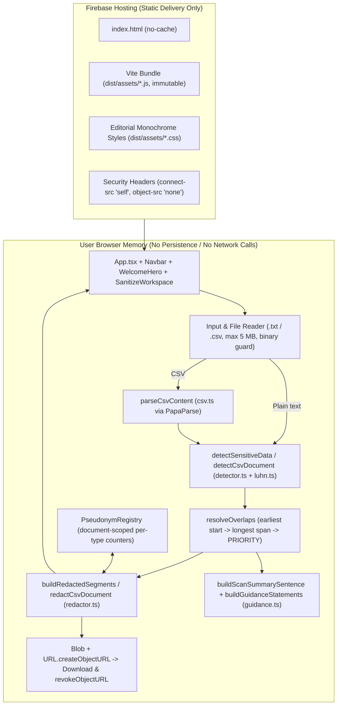
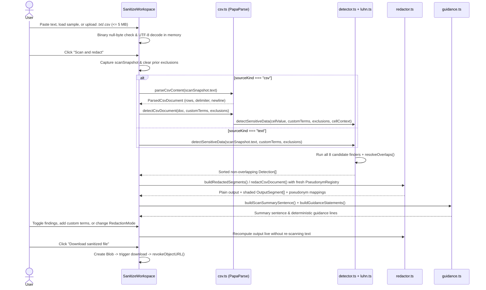

# VeilTrace — System Architecture & Function Reference

This document details the system design, client-only architecture, data flow, security boundaries, and function-level reference for **VeilTrace** (*Private Data Sanitization & Provenance Workbench*).

---

## 1. System Design Principles

1. **Zero-Server / Browser-Only Execution**: Static HTML/JS/CSS assets are served from Firebase Hosting (`dist/`). All file decoding, CSV parsing, PII pattern recognition, Luhn checksum verification, offset replacement, pseudonym mapping, and file export run strictly in browser memory.
2. **Immutable-Source Single-Pass Redaction**: Detected spans are resolved against the original input string using `[start, end)` offsets. Replacements are assembled in one forward pass rather than mutating the string iteratively, preventing offset drift.
3. **Deterministic & Explainable Rules**: Every detection carries a plain-language `reason` and a discrete status label (`Pattern match`, `Review recommended`, or `Passes Luhn check`) instead of opaque ML scores or external AI calls.
4. **Two-Phase Scan Snapshot**: Pre-scan keeps the interface focused on input and the **Scan and redact** action. Scanning snapshots the active text/CSV so subsequent edits trigger an explicit out-of-date notice (**Scan again**).
5. **Structure-Preserving CSV Pipeline**: CSV files are parsed into 2D cell matrices (`string[][]`), scanned per cell with document-wide pseudonym consistency, and serialized back to RFC 4180 CSV via `PapaParse`.

---

## 2. High-Level System Architecture



---

## 3. Data & Control Flow



---

## 4. Directory & Module Map

```text
Veiltrace/
├── index.html                      # Entry HTML, inline monochrome shield SVG favicon (no external assets)
├── package.json                    # Vite + React 18 + TypeScript + papaparse + lucide-react
├── vite.config.ts                  # Static build to dist/ (sourcemap: false)
├── firebase.json                   # Hosting root (dist), SPA rewrite, CSP & Cache-Control headers
├── .firebaserc                     # Default Firebase project target (veiltrace-d05ac)
├── README.md                       # Overview, setup, checklist, and limitations
├── PROMPT_LOG.md                   # Truthful development prompt history
├── docs/
│   └── ARCHITECTURE.md             # This system design & function reference
└── src/
    ├── main.tsx                    # React StrictMode mount
    ├── App.tsx                     # Top-level state (tab, input, mode, customTerms, exclusions, scanSnapshot)
    ├── index.css                   # Editorial monochrome design tokens & responsive layout
    ├── types/
    │   └── veiltrace.ts            # Core TypeScript domain types
    ├── data/
    │   └── promptLogData.ts        # Static development prompt log data for PromptLogView
    ├── lib/
    │   ├── luhn.ts                 # Mod-10 checksum validator for card candidates
    │   ├── detector.ts             # Candidate extractors, validators, normalizers, overlap resolver
    │   ├── redactor.ts             # Masking, single-pass offset replacer, PseudonymRegistry
    │   ├── csv.ts                  # RFC 4180 CSV parse, per-cell detection, and unparse serialization
    │   ├── guidance.ts             # Deterministic summary & plain-language guidance templates
    │   └── sampleData.ts           # Synthetic noisy .txt and .csv samples
    └── components/
        ├── Navbar.tsx              # Header navigation, shield mark, "Local processing" badge, mobile menu
        ├── WelcomeHero.tsx         # Headline, browser-only (.txt/.csv) notice, quick-start actions
        ├── SanitizeWorkspace.tsx   # Step 1 input/upload, Step 2 summary, custom terms, comparison & export
        ├── HowItWorksView.tsx      # Privacy boundaries, limitations, and Challenge Checklist table
        ├── PromptLogView.tsx       # Renders DEVELOPMENT_PROMPT_LOG (isolated from user data)
        └── AboutView.tsx           # Supported/unsupported format matrix & guarantee disclaimer
```

---

## 5. Function & Class Reference

### 5.1 Core Types (`src/types/veiltrace.ts`)
- `EntityType`: `'EMAIL' | 'PHONE' | 'IPV4' | 'IPV6' | 'PAN' | 'AADHAAR' | 'CARD' | 'CUSTOM'`
- `RedactionMode`: `'full' | 'partial' | 'pseudonym'`
- `ConfidenceLabel`: `'Pattern match' | 'Review recommended' | 'Passes Luhn check'`
- `Detection`: `{ id, type, value, normalizedValue, start, end, label, reason, included, rowIndex?, colIndex?, columnHeader? }`
- `CustomTerm`: `{ id, term }`
- `EntityMeta`: `{ type, label, shortLabel, description, partialExample, pseudonymPrefix }`
- `ParsedCsvDocument`: `{ rows: string[][], delimiter: string, newline: '\r\n' | '\n' }`
- `AppTab`: `'sanitize' | 'how-it-works' | 'prompt-log' | 'about'`

---

### 5.2 Luhn Checksum (`src/lib/luhn.ts`)
- **`passesLuhnCheck(digitsOnly: string): boolean`**
  - Validates that `digitsOnly` contains 13–19 digits (`/^\d{13,19}$/`).
  - Rejects all-identical digit sequences (such as `0000000000000000`) via `/^(\d)\1+$/`.
  - Computes standard right-to-left mod-10 doubling checksum and returns `sum % 10 === 0`.

---

### 5.3 Detection Engine (`src/lib/detector.ts`)
- **Constants**:
  - `ENTITY_META`: Metadata map (`label`, `shortLabel`, `description`, `partialExample`, `pseudonymPrefix`) for every `EntityType`.
  - `ALL_ENTITY_TYPES`: Ordered display array `['EMAIL', 'PHONE', 'CARD', 'PAN', 'AADHAAR', 'IPV4', 'IPV6', 'CUSTOM']`.
  - `PRIORITY`: Overlap tie-breaking weights: `CUSTOM (8) > EMAIL (7) > CARD (6) > AADHAAR (5) > PAN (4) > IPV6 (3) > IPV4 (2) > PHONE (1)`.
- **Validation & Normalization Helpers**:
  - `isWordChar(ch)` / `isDigitOrAlpha(ch)`: Boundary guards preventing partial matches inside alphanumeric tokens.
  - `isValidIPv4(raw)`: Requires 4 dot-separated octets matching `/^(?:0|[1-9]\d{0,2})$/` with numeric value `<= 255` (rejects leading zeros like `01` and out-of-range octets like `300`).
  - `normalizeIPv6(raw)`: Validates standard 8-hextet IPv6, compressed `::` notation (at most one `::`), and optional trailing IPv4-mapped notation; rejects timestamps (`14:35:22`) and invalid colon sequences; returns canonical 8-hextet lowercase string (`0000:0000:...`) for consistent pseudonymization.
  - `normalizePhone(raw)`: Strips non-digits and normalizes Indian 10-digit, `0`-prefixed 11-digit, and `91`-prefixed 12-digit `[6-9]` mobile numbers to `IN:<10-digits>`; preserves leading `+` for international numbers.
  - `escapeRegex(value)`: Escapes regex metacharacters in user-supplied custom terms.
- **Candidate Extractors**:
  - `findEmailCandidates(text)`: Boundary-checked `local@domain.tld`, rejecting leading/trailing/consecutive dots and leading/trailing domain hyphens; normalized to lowercase.
  - `findCardCandidates(text)`: Matches 13–19 digit card groupings with spaces or hyphens, rejects embedded dotted/hyphenated tokens, and filters through `passesLuhnCheck()`.
  - `findAadhaarCandidates(text)`: Matches `XXXX XXXX XXXX`, `XXXX-XXXX-XXXX`, or unspaced `[2-9]\d{11}` with strict lookaround checks so 12-digit slices of 16-digit cards or longer IDs are never extracted.
  - `findPanCandidates(text)`: Matches `[A-Z]{5}[0-9]{4}[A-Z]` with alphanumeric boundary guards.
  - `findIPv6Candidates(text)`: Extracts colon-hex candidates and validates with `normalizeIPv6()`.
  - `findIPv4Candidates(text)`: Extracts 4-octet candidates, rejects longer dotted chains (`10.20.30.40.50`) and alphanumeric prefixes (`v2.4.1.0`), and validates with `isValidIPv4()`.
  - `findPhoneCandidates(text)`: Matches international (`+...`), Indian (`0`-prefixed, `98765 43210`, `9876543210`), and parenthesized `(555) 234-5678` formats with boundary guards against cards, IPs, dates, and tracking numbers.
  - `findCustomCandidates(text, customTerms)`: Matches session-only user terms case-insensitively with word boundaries on alphanumeric edges.
- **Overlap Resolution & Public Entry**:
  - `resolveOverlaps(candidates)`: Sorts by `start` ascending, then span length descending, then `PRIORITY` descending, and greedily keeps non-overlapping spans (`cand.start >= lastEnd`).
  - **`detectSensitiveData(text, customTerms?, existingExclusions?, cellContext?)`**: Runs all 8 extractors, resolves overlaps, generates deterministic IDs (`r{row}-c{col}-{type}:{start}-{end}` for CSV or `{type}:{start}-{end}` for text), and preserves user `included` toggles from `existingExclusions`.

---

### 5.4 Redaction & Pseudonymization (`src/lib/redactor.ts`)
- **`PseudonymRegistry` (class)**:
  - `getOrCreate(type, normalizedValue)`: Maintains per-`EntityType` maps in memory and assigns sequential 2-digit padded tokens (`EMAIL_01`, `CARD_01`, etc.) per normalized value within a single document.
  - `getSummary()`: Returns active `{ type, normalizedValue, token }` mappings for UI inspection.
- **`maskPartial(detection)`**: Conservative category-specific masking:
  - `CARD`: `**** **** **** <last4>`
  - `AADHAAR`: `XXXX XXXX <last4>`
  - `PHONE`: `******<last4>` (at least 4 masks + last 4 digits)
  - `EMAIL`: `<firstChar>***@<domain>` (or `***@<domain>` for 1-char local parts)
  - `PAN`: `********<last2>`
  - `IPV4`: `<octet1>.<octet2>.*.*`
  - `IPV6`: `<firstSegment>:****:****`
  - `CUSTOM`: `<firstChar>******` (up to 6 asterisks, or `***` if length `<= 2`)
- **`formatReplacement(detection, mode, registry)`**: Dispatches `'full'` (`[REDACTED: TYPE]`), `'partial'` (`maskPartial`), or `'pseudonym'` (`PseudonymRegistry.getOrCreate`).
- **`buildRedactedSegments(originalText, detections, mode, registry)`**: Single-pass offset assembler returning `{ text: string, segments: OutputSegment[] }` so the UI can shade replaced tokens while downloads/copy use the exact plain `text`.
- **`applyRedactionsToText(...)`**: Convenience wrapper returning `buildRedactedSegments(...).text`.

---

### 5.5 CSV Pipeline (`src/lib/csv.ts`)
- **`parseCsvContent(rawCsv: string): ParsedCsvDocument`**: Uses `Papa.parse` (`header: false`, `skipEmptyLines: false`, `dynamicTyping: false`), detects `\r\n` vs `\n`, trims trailing empty EOF line artifact, and preserves delimiter metadata.
- **`detectCsvDocument(doc, customTerms, existingExclusions): Detection[]`**: Iterates every row/column cell and invokes `detectSensitiveData()` with `rowIndex`, `colIndex`, and `columnHeader` context.
- **`redactCsvDocument(doc, detections, mode, registry)`**: Groups detections by `(rowIndex, colIndex)`, redacts each cell using a shared document-level `PseudonymRegistry`, and serializes back to valid RFC 4180 CSV via `Papa.unparse` (`quotes: false`, `escapeChar: '"'`, `quoteChar: '"'`), preserving commas, escaped quotes (`""`), and embedded newlines.

---

### 5.6 Deterministic Guidance (`src/lib/guidance.ts`)
- **`buildScanSummarySentence(detections)`**: Generates accurate singular/plural summary (e.g., `"We found 16 items to review across 7 categories."` or `"No supported patterns were found in this document."`).
- **`buildGuidanceStatements(detections, mode)`**: Emits factual template sentences from active and excluded counts by entity type, including explicit caveats for Luhn checksums, PAN/Aadhaar format-only matching, partial masking clues, and manual review.

---

### 5.7 UI Components (`src/components/*` & `src/App.tsx`)
- **`App.tsx`**: Holds in-memory React state (`activeTab`, `rawInput`, `sourceName`, `sourceSizeBytes`, `sourceKind`, `mode`, `customTerms`, `exclusions`, `scanSnapshot`, `mappingEpoch`) and routes across tabs.
- **`Navbar.tsx`**: Sticky monochrome header with geometric shield mark, `Sanitize` / `How It Works` / `Prompt Log` / `About` navigation, `Local processing` status pill, and collapsible mobile menu.
- **`WelcomeHero.tsx`**: Headline, `.txt`/`.csv`-only browser-processing notice, and quick-start buttons (`Paste text`, `Upload .txt or .csv`, `Try sample`, `Try CSV sample`).
- **`SanitizeWorkspace.tsx`**:
  - Step 1: Drag-and-drop + file input (`.txt`/`.csv`, `MAX_FILE_BYTES = 5 MB`, null-byte binary check via `Uint8Array`), editable textarea, `Remove file`, and `Clear data` confirmation dialog (`Escape` support).
  - Pre-scan / Out-of-date gating: Hides results prior to scan; computes `isOutOfDate` when `rawInput !== scanSnapshot.text` and displays **Scan again**.
  - Step 2: Summary cards, **Temporary custom terms** panel with confirmation status, keyboard-operable mode `radiogroup` (`ArrowLeft`/`ArrowRight`), side-by-side `Highlighted Original` (click-to-inspect details) and shaded `Sanitized Output`, CSV `Table view`/`Raw CSV` toggle, `Copy sanitized output`, `Download sanitized file` (with `URL.revokeObjectURL`), **What Changed** guidance, and collapsible **Review findings**.
- **`HowItWorksView.tsx`**, **`PromptLogView.tsx`**, **`AboutView.tsx`**: Privacy architecture explanation, truthful prompt history, format matrix, limitations, and Challenge Checklist.

---

## 6. Security & Privacy Controls

| Control | Implementation |
|---|---|
| Network isolation | `Content-Security-Policy` in `firebase.json` sets `connect-src 'self'`, `script-src 'self'`, `font-src 'self'`, `object-src 'none'`, `frame-ancestors 'none'`. |
| Referrer & permissions | `Referrer-Policy: no-referrer`, `X-Content-Type-Options: nosniff`, `X-Frame-Options: DENY`, `Permissions-Policy: camera=(), microphone=(), geolocation=()`. |
| Zero persistence | No `localStorage`, `sessionStorage`, `IndexedDB`, cookies, URL query encoding, or `console.log` of user inputs. |
| XSS / HTML injection defense | File contents and CSV cells are rendered exclusively through React text nodes—never `dangerouslySetInnerHTML`. |
| Memory cleanup | Temporary object URLs created for downloads are revoked after `1000ms` via `URL.revokeObjectURL`; `Clear data` wipes all working state. |
| Cache hygiene | `/`, `/index.html` serve `Cache-Control: no-cache, no-store, must-revalidate`; hashed `/assets/**` serve `immutable` 1-year cache. |
